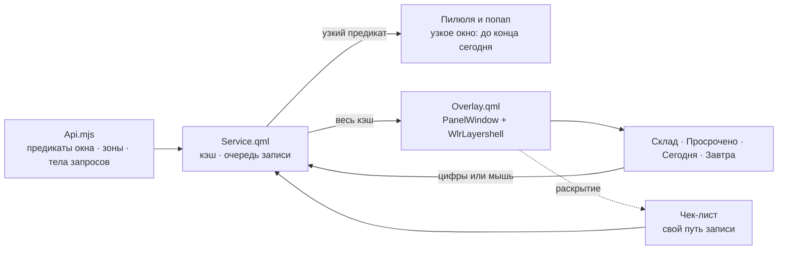

# Оверлей: склад и три дня — Plan

## Goal Capsule

**Задача.** Третья и последняя поверхность плагина: полноэкранный оверлей, в котором задачи
без даты разбираются по дням. Не витрина состояния, а инструмент планирования.

**Владелец решения.** Игорь. Раскладка выбрана 07.09 по макету на живых данных.

**Открытых блокеров нет.** Форма API снята разведкой, устройство оболочки — досье
`/tmp/compound-engineering-1000/ce-brainstorm/sng4/grounding.md` (временное; ключевое
перенесено сюда).

## Product Contract

### Что установлено фактом

**API.** Дату меняет `PATCH /v2/task/{id}` с полем `start` — проверено на живой задаче.
`POST /v2/task/{id}/move` к датам отношения не имеет: он переносит между проектами
(`projectId`, `groupId`, `parent`). Чек-листы: `POST /v2/checklist-item` (`parent`, `title`),
отметка `/check` и `/uncheck`, выборка по `parent.eq` — всё проверено на пробной задаче.

**Оболочка.** Готового приёма для полноэкранного окна нет: и `mirador`, и штатный
`SpeedTestOverlay` объявляют `PanelWindow` + `WlrLayershell` сами. Перетаскивания в общих
компонентах тоже нет — единственный работающий образец во всей системе это связка
`DragHandler` + `Drag` + `DropArea` внутри `mirador`. `Esc` даёт общий `PanelKeyCatcher`, тот
же, что уже держит попап; закрытие по клику мимо — обычный `MouseArea` во всю площадь, как в
образце.

**Кэш сервиса не содержит того, из чего строится оверлей** (замер 07.09, после ревью плана).
Окно сервиса отсекает склад и «Завтра» дважды: запрос `todayQuery` не просит ничего позже
конца сегодняшнего дня (`Api.mjs:42-44`), а предикат `isCurrent` выбрасывает задачи без
`start` уже на стороне клиента (`Api.mjs:114-119`), и через него проходит всё, что попадает
в `allTasks`.

| Запрос | Всего | Без даты | Завтра |
| --- | --- | --- | --- |
| Окно сервиса (`checked.eq=0` + `start.lte=<конец сегодня>`) | **2** | **0** | 0 |
| Без фильтра по `start` (`checked.eq=0`) | **192** | **188** | 0 |

Число 192 из раздела «Данные» снято прямым запросом к API, а не из кэша. На нынешнем кэше
оверлей показал бы две карточки из ста девяноста двух — и выглядело бы это как «данные ещё
не пришли». Отсюда R10.

**Данные.** Из 192 незавершённых задач заданное начало есть у четырёх: просрочено 2,
сегодня 0, завтра 1, дальше 1. Остальные **188 — без `start`**, разложены по 21 проекту;
три крупнейших — «Контур ir-gsm» (50), «Счета и контрагенты» (49), ERP (25).

### Key Decisions

**KD1. Четыре зоны, а не три колонки.**
`session-settled: user-directed` — выбрано владельцем 07.09; отвергнуто: три колонки, как
было записано в карточке.

Без склада оверлей показал бы три карточки из ста девяноста двух, а 188 задач без даты не
попали бы в него вовсе. Со складом он становится тем, чем должен: местом, где входящие
разбирают по дням.

**KD2. Склад слева сеткой по проектам, три дня справа колонками.**
`session-settled: user-directed` — выбрано владельцем 07.09 по макету на живых данных;
отвергнуты: четыре равные колонки, дни лентой сверху, склад одной лентой.

Ось задаёт клавиатура. Перенос стрелками требует, чтобы «вправо» буквально значило
«в день»; при днях сверху пришлось бы занять «вверх», которой ходят по карточкам. Дни
вертикальными колонками вмещают рост — сегодня их три, но планирование наполнит их
десятками. Склад берёт от отвергнутого варианта плотную сетку: 21 проект стопками читается,
сплошная лента из 188 строк — нет.

**KD3. Одна раскладка на всех экранах.**
`session-settled: user-directed` — выбрано владельцем 07.09 после того, как макет показал
тесноту на ноутбуке; отвергнуты: переключение раскладки по ширине и сжатие до двух дней.

На ноутбуке (логически 1536 px) колонки дней ужимаются примерно до 205 px и обрезают даже
собственный заголовок. Это принято сознательно: оверлей чаще открывается на внешнем
мониторе, а вторая раскладка означала бы второй путь в коде и вторую живую проверку.

**KD4. Перенос стрелками — основное требование, а не улучшение.**

В карточке он стоял «со звёздочкой». После KD2 он перестал быть бонусом: раскладка выбрана
**из-за** него, и оверлей, вызываемый хоткеем, обязан работать без мыши целиком.

**KD5. Чек-листы делаются здесь.**
`session-settled: user-directed` — решение владельца 07.09; отвергнуто: вынести в отдельную
задачу.

Живых данных нет — во всём аккаунте ноль пунктов, — поэтому проверка идёт на специально
заведённых и удаляемых после.

### Requirements

- **R1.** `omarchy-shell shell summon io.github.igorkramar.singularity '{}'` открывает
  оверлей, `hide` закрывает, `Esc` закрывает, клик мимо закрывает.
- **R2.** Четыре зоны заполняются из кэша сервиса: склад — незавершённые задачи без `start`;
  «Просрочено» — начало раньше сегодняшнего дня; «Сегодня» и «Завтра» — соответствующие
  локальные дни.
- **R3.** Склад сгруппирован по проектам, группы упорядочены по числу задач. Двести задач в
  нём прокручиваются, и открытие оверлея не подвисает.
- **R4.** Перетаскивание карточки мышью в колонку дня проставляет `start` на этот день через
  `PATCH`; перетаскивание в склад снимает дату.
- **R5.** То же делается с клавиатуры. Весь путь — открыть, выбрать, перенести, закрыть —
  проходится без мыши. Конкретные клавиши — KTD1: стрелки водят курсор по всем четырём
  зонам, перенос идёт цифрами.
- **R6.** Результат переноса виден в веб-приложении и в счётчике пилюли; ошибка записи
  сообщается и не меняет список молча.
- **R7.** У карточки раскрывается чек-лист; пункты отмечаются и снимаются через API.
- **R8.** Оверлей выглядит как первопартийные поверхности: цвета, отступы и скругления из
  `Commons/`, а не собственные значения.
- **R9.** Каркас вкладок заложен, «Задачи» — первая и единственная заполненная; вкладки
  переключаются с клавиатуры (`Tab`). Привычки и время придут в SNG-5.
- **R10.** Окно кэша расширяется до всех незавершённых задач, иначе три зоны из четырёх
  пусты. **Счётчик пилюли и попап при этом не меняются**: они продолжают считать и
  показывать прежнее узкое окно «всё до конца сегодня» (этого прямо требует AE2).

### Acceptance Examples

- **AE1.** Оверлей вызван командой оболочки. Виден склад со стопками проектов и три колонки
  дней. `Esc` закрывает.
- **AE2.** Задача «Купить новые штаны» перетащена мышью из склада в «Завтра». В
  веб-приложении у неё появилось завтрашнее начало; счётчик пилюли не изменился (завтра не
  входит в окно), а после наступления завтра — изменится.
- **AE3.** Курсор поставлен на карточку в складе, нажата `→`. Карточка ушла в «Сегодня»,
  счётчик пилюли вырос на единицу.
- **AE4.** Карточка из «Сегодня» отправлена `←` в склад. Дата снята, задача исчезла из
  счётчика.
- **AE5.** У задачи заведены два пункта чек-листа. Карточка раскрыта, оба видны; отметка
  первого отражается в веб-приложении.
- **AE6.** Токен неверен. Оверлей открывается, показывает прежний список и говорит об
  ошибке; перенос не делает вид, что удался.

### Scope Boundaries

**Не входит:**

- Вкладки привычек и учёта времени — SNG-5. Здесь только каркас, в который они встанут.
- Хоткей Hyprland, пункт меню и CLI — SNG-6. Здесь оверлей вызывается командой оболочки.
- Вторая раскладка для узкого экрана (KD3).
- Создание задач и чек-листов из оверлея: он разбирает существующее. Быстрое добавление уже
  есть в попапе.

### Со звёздочкой

- [ ] **Отмена последнего переноса.** Перетащить не в ту колонку легко, а вернуть — значит
      найти карточку в новой колонке и перетащить обратно. По образцу отмены отметки из
      SNG-3.1: подвал называет перенесённую задачу и предлагает вернуть её клавишей, на один
      шаг назад. Механизм записи для этого уже есть — нужна только память о последнем
      переносе и обратный `PATCH`.

---

## Planning Contract

**Сохранение Product Contract:** требования, ключевые решения и границы сохранены. Ревью
плана и замер 07.09 добавили факт про кэш (R10) и заставили переписать раскладку клавиш
(KTD1) — оба изменения зафиксированы ниже как решения, а не растворены в тексте.

### Key Technical Decisions

**KTD1. Стрелки водят курсор, перенос идёт цифрами, вкладки — на `Tab`.**
Инстанцирует KD4; governs R5, R9.

Первая редакция плана отдавала `→` переносу в «Сегодня». Ревью показало, что клавиш на это
не хватает, и по трём причинам сразу:

1. `PanelKeyCatcher` поднимает `←`/`→` тем же сигналом `moveRequested`, что и `↑`/`↓`
   (`PanelKeyCatcher.qml:65-70`) — курсору и переносу досталась бы одна клавиша.
2. Склад по KD2 — **сетка** стопок по проектам. Сетку нельзя обойти одними `↑`/`↓`:
   до второй колонки стопок курсору нечем дотянуться, и R5 («весь путь без мыши») не
   выполняется.
3. Перехватчик отдаёт всего семь сигналов, и `Tab` был единственным, чем можно переключать
   вкладки (R9). Отдав его зонам, мы оставили бы вкладки недостижимыми.

Раскладка, в которой ни одна клавиша не значит двух вещей:

| Клавиша | Значение |
| --- | --- |
| `↑` `↓` `←` `→` (и `k` `j` `h` `l`) | курсор по сетке; границы зон переходятся как обычные границы |
| `Tab` / `Shift+Tab` | вкладка вперёд / назад |
| `1` | отправить в «Сегодня» |
| `2` | отправить в «Завтра» |
| `0` | снять дату — вернуть на склад |
| `Enter` (и `Space`) | раскрыть чек-лист |
| `Esc` | закрыть оверлей |

Четыре зоны образуют одно пространство, и курсор ходит по нему стрелками — это ближе к тому,
что видно на экране, чем разделение «внутри зоны стрелками, между зонами `Tab`».
«Просрочено» целью переноса не является: в прошлое не переносят.

**Занято перехватчиком и потому не наше:** `h` `j` `k` `l` (стрелки), `x`/`X`
(`deleteRequested` — сигнал не подключаем, удаления у плагина нет), `Space` (тот же сигнал,
что `Enter`). До `textKey` доходят только символы, не разобранные шестью ветвями выше
(`PanelKeyCatcher.qml:59-84`) — цифры доходят, буквы из этого списка нет.

**KTD2. Окно кэша расширяется, а счётчик получает собственный предикат.**
Governs R10, R2; следствие замера.

Запрос теряет `start.lte` целиком и просит все незавершённые задачи — 192 против нынешних
двух, при `MAX_COUNT` в тысячу. Отдельного запроса под оверлей не заводим: «без даты **или**
до конца завтра» одним фильтром API не выражается, а два запроса — это два пути, которые
разойдутся.

Клиентский предикат `isCurrent` расщепляется надвое: **что держим в кэше** (все
незавершённые) и **что считает пилюля и показывает попап** (прежнее «до конца сегодня»).
Второй предикат — это ровно нынешнее правило, перенесённое без изменений, поэтому пилюля и
попап обязаны остаться прежними; AE2 требует этого прямо.

Это самая опасная правка задачи: она трогает работающие поверхности ради третьей. Отсюда
отдельный юнит, идущий раньше всего остального, и регрессионные тесты на неизменность
счётчика.

**KTD3. Окно объявляется плагином по образцу `mirador`, вместе с выбором экрана.**
Governs R1.

Готового приёма для полноэкранной поверхности в оболочке нет: и `mirador`, и штатный
`SpeedTestOverlay` пишут `PanelWindow` + `WlrLayershell` сами. Берём тот же набор:
`WlrLayer.Overlay`, `keyboardFocus: Exclusive`, `exclusionMode: Ignore`, прозрачный фон,
`anchors` на все четыре стороны.

Экран выбирается при открытии — тот, на котором фокус (`Hyprland.focusedMonitor`), а не
первый в списке. KD3 целиком про разницу между ноутбуком и внешним монитором, то есть
несколько экранов заведомо в игре.

**`close()` и `dismiss()` — разные вещи.** `close()` зовёт оболочка. Когда окно закрывает сам
пользователь (`Esc`, клик мимо), оверлей обязан дополнительно позвать `shell.hide(id)`, иначе
оболочка останется в убеждении, что он открыт, и следующий вызов ничего не откроет. Признак
и свойство разойдутся молча — тот самый класс, что разобран в `docs/solutions/`.

**KTD4. Раскладка по зонам — чистая функция `overlayView(prev, args)`.**
Governs R2, R3.

Правило «в какую зону попадает задача» ошибается молча: задача просто оказывается не в той
колонке. `AGENTS.md` для таких решений требует `Api.mjs`, где до них дотягивается
`node --test`. Форма — как у `popupView`: одна точка входа, один объект на выходе, прежние
ссылки внутри, чтобы QML имел одно свойство и одно присваивание.

Склад сортируется **по числу задач**, а не по названию (R3), поэтому `groupByProject`
переиспользуется только для сборки групп; порядок задаётся своим сравнением поверх, с тем же
тихим гейтом.

**KTD5. Перенос идёт через очередь записи, расширенную полем цели.**
Governs R4, R5, R6.

Очередь в `Service.qml` (`mutationQueue`, `mutatingId`, `pendingIds`, `mutationError`) уже
несёт координацию с опросом и признак «в пути». Но запись очереди — `{id, op, title}`, а
`mutationBody(op, title, now)` про даты не знает: цель переноса положить некуда. Запись
получает поле цели, а `mutationBody` — ветку переноса.

Два капкана, оба тихие:
- неизвестный `op` роняет `mutationBody` исключением (`Api.mjs:757`) прямо в сеттере QML —
  новая операция обязана быть заведена в обеих таблицах;
- тело «снять дату» это `{start: null}`, а **не** `null`: пустое тело `enqueueMutation`
  отвергает молча, и снятие даты просто не отправлялось бы.

**KTD6. Чек-листы идут своим путём записи, а не общей очередью задач.**
Governs R7.

Обработчик ответа мутации безусловно прогоняет ответ через `parseTask` и вливает в
`allTasks` (`Service.qml:296-320`). Ответ `/v2/checklist-item/{id}/check` — это **пункт**, а
не задача: у него есть `id`, поэтому разбор пройдёт, слепит псевдозадачу и вольёт её в кэш
задач, а `pendingIds` смешает идентификаторы пунктов с идентификаторами задач в одном
пространстве. Путь чек-листов отделён от очереди задач по этой причине, а не ради симметрии.

Пункты грузятся по требованию — при раскрытии карточки, один запрос на карточку, — и кэш
пунктов живёт отдельным свойством.

### High-Level Technical Design

---

## Implementation Units

### U1. Окно кэша и разведение счётчика

- **Goal:** в кэше есть все незавершённые задачи, а пилюля и попап показывают ровно то же,
  что показывали.
- **Requirements:** R10, R2; KTD2.
- **Dependencies:** нет. **Идёт первым:** без него остальные юниты нечем наполнить.
- **Files:** `Api.mjs`, `test/api.test.mjs`, `Service.qml`.
- **Approach:**
  1. Запрос задач теряет `start.lte`; `MAX_COUNT` не трогаем — запас пятикратный.
  2. `isCurrent` расщепляется: предикат кэша (незавершённая, не удалённая, не отложенная) и
     предикат узкого окна (прежнее правило целиком, включая `!task.start → false`).
  3. Пилюля и попап переводятся на узкий предикат явным вызовом, а не по умолчанию.
- **Patterns to follow:** `isCurrent`, `mergeFull`, `countWindow` в `Api.mjs`; `recompute` в
  `Service.qml`.
- **Test scenarios:**
  - Covers R10. Задача без `start` остаётся в кэше и **не** попадает в узкое окно.
  - Covers R10. Завтрашняя задача остаётся в кэше и не попадает в узкое окно.
  - Covers R10, AE2. Регрессия: на наборе с задачами всех четырёх видов счётчик равен тому,
    что даёт нынешнее правило. Это тест на неизменность, он и есть страховка пилюли.
  - Covers R10. Завершённая, удалённая и отложенная задачи не попадают **ни** в кэш, ни в
    узкое окно.
  - Тихий гейт `mergeFull` сохраняется: повторный ответ с тем же набором возвращает прежнюю
    ссылку.
- **Verification:** `TZ=Asia/Omsk node --test test/api.test.mjs` зелёный; живьём — число на
  пилюле до и после правки совпадает.

### U2. Окно оверлея и его жизненный цикл

- **Goal:** оверлей открывается на нужном экране, закрывается тремя способами и не рассыпает
  синхронизацию с оболочкой.
- **Requirements:** R1; KTD3.
- **Dependencies:** нет.
- **Files:** `Overlay.qml`.
- **Approach:**
  1. `PanelWindow` со слоем `Overlay`, эксклюзивным клавиатурным фокусом, игнорированием зон
     исключения, прозрачным фоном и привязкой ко всем четырём сторонам.
  2. Экран выбирается в `open()` по `Hyprland.focusedMonitor`, с откатом на первый; окно
     видимо только когда экран найден.
  3. Сохранить свойства `shell`, `manifest`, `service`, `opened` и методы `open`/`close`/
     `toggle` — их зовёт загрузчик панелей.
  4. Развести `close()` (зовёт оболочка) и `dismiss()` (`Esc`, клик мимо → плюс
     `shell.hide(id)`).
  5. `MouseArea` во всю площадь под содержимым; `PanelKeyCatcher` с отложенным запросом
     фокуса.
- **Patterns to follow:** `mirador/WorkspaceOverview.qml:164-205, 255-282`.
- **Test scenarios:** автоматических нет — QML вне досягаемости `node --test`.
- **Execution note:** после первой загрузки прочитать журнал оболочки: присваивание
  несуществующему свойству QML принимает молча.
- **Verification:** оверлей открывается на экране с фокусом; `Esc`, клик мимо и команда
  оболочки закрывают; **повторный вызов после каждого из трёх способов снова открывает** —
  это и есть проверка `dismiss`.

### U3. Раскладка по зонам

- **Goal:** решение «в какую зону попадает задача» живёт там, где его проверяет тест.
- **Requirements:** R2, R3; KTD4.
- **Dependencies:** U1.
- **Files:** `Api.mjs`, `test/api.test.mjs`.
- **Approach:**
  1. `overlayView(prev, args)` раскладывает кэш по четырём зонам: без `start` — склад;
     раньше начала сегодняшнего дня — просрочено; сегодня и завтра — свои дни.
  2. «Завтра» считать календарно (`setDate(+1)`), а не прибавлением суток в миллисекундах —
     в день перевода стрелок сложение промахивается на час и кладёт задачу в соседнюю зону.
  3. Склад: группы через `groupByProject`, порядок — по числу задач по убыванию, с тихим
     гейтом поверх.
  4. Задачи дальше завтра в оверлее не показываются: в кэше они есть (одна штука), зоны для
     них нет. Назвать это в тесте явно, чтобы поведение было решённым, а не случайным.
- **Patterns to follow:** `popupView` — форма точки входа; `sameGroups` — тихий гейт;
  `startOfDay`/`endOfDayDate` — границы суток.
- **Test scenarios:**
  - Covers R2. Задача без `start` — в склад, а не в «Просрочено».
  - Covers R2. Вчера → «Просрочено»; сегодня → «Сегодня»; завтра → «Завтра»; послезавтра —
    ни в одну зону.
  - Covers R2. Граница суток: начало ровно в полночь сегодня → «Сегодня».
  - Covers R2. Задача, начинающаяся завтра в 23:59, → «Завтра», а не мимо зон.
  - Covers R3. Склад сгруппирован по проектам, группы упорядочены по числу задач по
    убыванию; задача без проекта — в отдельной группе.
  - При неизменных данных повторный вызов возвращает **ту же ссылку**.
- **Verification:** `TZ=Asia/Omsk node --test test/api.test.mjs` зелёный.

### U4. Каркас вкладок и общий вид

- **Goal:** оверлей выглядит как первопартийные поверхности и несёт вкладку «Задачи».
- **Requirements:** R8, R9; KTD1, KTD3.
- **Dependencies:** U2.
- **Files:** `Overlay.qml`.
- **Approach:**
  1. Цвета — роль `menu` в `Commons/Color.qml`, отступы — `Style.space()`, скругления —
     `Style.cornerRadius`, состояния — `Style.selectedFillFor`/`hoverFillFor`. Своих чисел не
     вводить.
  2. Вкладки — `Ui/ButtonGroup`, как в попапе; переключение на `tabRequested` (`Tab`).
  3. Пустых вкладок привычек и времени не заводить: каркас — это место, а не заглушки.
- **Patterns to follow:** `Panel.qml:451-468` — полоса вкладок; `TaskRow.qml` — токены вместо
  чисел.
- **Test scenarios:** автоматических нет — оформление проверяется глазами.
- **Verification:** рядом с первопартийной поверхностью не выделяется; смена темы оболочки
  меняет и его цвета; `Tab` не проваливается в прогулку по панелям бара.

### U5. Склад и колонки дней

- **Goal:** четыре зоны нарисованы, заполнены и обходятся курсором.
- **Requirements:** R2, R3, R5; KD2, KTD1.
- **Dependencies:** U2, U3, U4.
- **Files:** `Overlay.qml`, `TaskCard.qml` (создать).
- **Approach:**
  1. Склад слева, три дня справа; пропорция примерно три к двум.
  2. Склад — сетка стопок по проектам с прокруткой; колонка дня — вертикальный список.
  3. Карточка: название, признак высокого приоритета, дедлайн если есть; длинное название
     обрезается многоточием.
  4. Курсор — по идентификатору задачи, не по индексу: опрос может вставить задачу выше
     выделенной. Движение — по видимой геометрии, а не по порядку модели: в сетке это разные
     вещи.
- **Patterns to follow:** `TaskRow.qml` — устройство строки; `Panel.qml` — курсор по
  идентификатору.
- **Test scenarios:** автоматических нет; наполнение зон покрыто тестами U3.
- **Verification:** живьём на 188 карточках склад прокручивается, открытие не подвисает;
  курсор стрелками доходит до любой карточки любой зоны, включая вторую колонку стопок.

### U6. Перенос с клавиатуры

- **Goal:** весь путь проходится без мыши.
- **Requirements:** R5, R6; KD4, KTD1, KTD5.
- **Dependencies:** U5.
- **Files:** `Api.mjs`, `test/api.test.mjs`, `Service.qml`, `Overlay.qml`.
- **Approach:**
  1. Чистая функция: цифра на входе — целевая зона на выходе; вторая — зона на входе, `start`
     (или его снятие) на выходе. Отметка времени пишется как в `buildCreateBody`: 09:00
     локального дня с локальным смещением.
  2. Запись очереди получает поле цели; `mutationBody` — ветку переноса; обе таблицы
     (`MUTATIONS` и `mutationBody`) пополняются вместе.
  3. Карточка в пути помечается через `pendingIds`, как строка попапа.
- **Patterns to follow:** `resolveActionKey`, `mutationBody`, `buildCreateBody`;
  `enqueueMutation`/`drainMutations` в `Service.qml`.
- **Test scenarios:**
  - Covers R5. `1`, `2`, `0` дают свои зоны; прочие символы — ничего.
  - Covers R5. «Сегодня» → `start` на сегодня 09:00; «Завтра» → завтра 09:00; склад → снятие.
  - Covers R6. Тело снятия даты — `{start: null}`, а не пустое: пустое очередь отвергает
    молча.
  - Covers R6. Каждая заведённая операция присутствует **в обеих** таблицах — иначе
    исключение прилетит в сеттере QML.
  - Covers AE3, AE4. Перенос на «Сегодня» и обратно возвращает исходное состояние.
- **Verification:** живьём: курсор стрелками, перенос цифрами, изменение видно в
  веб-приложении; счётчик пилюли меняется только для «Сегодня».

### U7. Перетаскивание мышью

- **Goal:** то же, что U6, но мышью.
- **Requirements:** R4, R6; KTD4 образца, KTD5.
- **Dependencies:** U6.
- **Files:** `Overlay.qml`, `TaskCard.qml`.
- **Approach:**
  1. Источник — `DragHandler` с `target: null` и порогом; позицию несёт прокси-`Item` с
     `Drag.active`, `Drag.source` и своим ключом.
  2. Приёмник — `DropArea` с тем же ключом на каждой зоне, подсветка через `containsDrag`.
  3. По сбросу вызывается тот же метод сервиса, что в U6 — путь записи один.
- **Patterns to follow:** `mirador/WindowPreview.qml:174-210` и
  `mirador/WorkspaceCard.qml:244-259`.
- **Test scenarios:** автоматических нет — перетаскивание живёт в QML.
- **Execution note:** проверка синтезом ввода; демон поднимать на время и снимать по PID с
  проверкой `pgrep`.
- **Verification:** живьём: карточка переносится из склада в день и обратно, приёмник
  подсвечивается.

### U8. Чек-лист карточки

- **Goal:** у задачи раскрывается чек-лист, пункты отмечаются и снимаются.
- **Requirements:** R7; KD5, KTD6.
- **Dependencies:** U5.
- **Files:** `Api.mjs`, `test/api.test.mjs`, `Service.qml`, `Overlay.qml`.
- **Approach:**
  1. Разбор списка пунктов и тела запросов отметки — чистыми функциями.
  2. В сервисе — **отдельный** путь: свой процесс, свой кэш пунктов по идентификатору задачи,
     свой набор «в пути». Ответ пункта в `allTasks` не вливать.
  3. В карточке — раскрытие по `Enter`/`Space`, отметка как галочка в попапе.
- **Patterns to follow:** `parseTasks`/`normalizeTask` — разбор; `TaskRow.qml` — чекбокс.
- **Test scenarios:**
  - Covers R7. Список пунктов разбирается; пустой ответ даёт пустой список, а не ошибку.
  - Covers R7. Тела отметки и снятия различаются и адресуют разные пути.
  - Covers AE5. Пункт с `done: true` отличим от пункта без него и от пункта, где поля нет.
- **Execution note:** живых чек-листов в аккаунте нет — проверка на заведённых и удаляемых
  после.
- **Verification:** живьём: чек-лист раскрывается, отметка видна в веб-приложении; **кэш
  задач при этом не меняется** (счётчик пилюли не дрогнул).

### U9. Ошибка записи на виду

- **Goal:** отказ записи виден в оверлее и не выглядит как успех.
- **Requirements:** R6; AE6.
- **Dependencies:** U6.
- **Files:** `Overlay.qml`.
- **Approach:**
  1. Подвал оверлея показывает класс ошибки через существующий `errorClass` — сырой текст
     наружу не идёт.
  2. Отказ повтора (`enqueueMutation` возвращает `false`) сообщается, а не проглатывается:
     сейчас он молчит, и R6 это запрещает.
- **Patterns to follow:** `errorClass` в `Api.mjs`; подвал попапа в `Panel.qml`.
- **Test scenarios:** классификация покрыта тестами `errorClass`; отображение — глазами.
- **Verification:** живьём с испорченным токеном: оверлей открывается, показывает прежний
  список и говорит об ошибке (AE6).

### U10. README

- **Goal:** оверлей описан там, где его прочтут.
- **Requirements:** R1, R5, R9, R10.
- **Dependencies:** U1–U9.
- **Files:** `README.md`.
- **Approach:** чем оверлей отличается от попапа; как вызывается сегодня (команда оболочки,
  хоткей — SNG-6); полная раскладка клавиш из KTD1; что склад — это задачи без даты; что
  окно кэша расширено, а счётчик пилюли остался прежним.
- **Verification:** `bash test/omarchy-plugin-validate "$PWD"` без ошибок.

---

## Verification Contract

| Проверка | Команда | Юниты | Признак |
| --- | --- | --- | --- |
| Тесты модуля | `TZ=Asia/Omsk node --test test/api.test.mjs` | U1, U3, U6, U8 | зелёные, число выросло |
| Манифест и файлы | `bash test/omarchy-plugin-validate "$PWD"` | все | код возврата 0 |
| Статический разбор QML | `qmllint Overlay.qml TaskCard.qml` | U2, U4, U5, U7 | без ошибок |
| Журнал оболочки | перезапуск, поиск по идентификатору плагина | U2 | ни одного предупреждения |
| Пилюля не дрогнула | число на пилюле до и после U1 | U1 | совпадает |
| Открытие и закрытие | команда, `Esc`, клик мимо — и **повторное** открытие после каждого | U2 | все три способа, окно открывается снова |
| Наполнение зон | живые данные | U5 | склад ≈188 карточек стопками, дни — свои |
| Обход курсором | стрелки по всем зонам | U5 | достижима любая карточка, включая вторую колонку стопок |
| Перенос клавишами | `1`, `2`, `0` | U6 | дата меняется, видно в вебе |
| Перенос мышью | перетаскивание | U7 | то же, приёмник подсвечивается |
| Чек-лист | пробная задача с пунктами | U8 | раскрывается, отметка доходит, кэш задач цел |
| Ошибка записи | испорченный токен | U9 | AE6 |
| Большое окно | 188 карточек склада | U5 | прокрутка, открытие без подвисания |
| CI | джоб `check` | U1, U3, U6, U8 (QML не покрыт) | зелёный |

**Чего проверки не доказывают.** CI держит только `Api.mjs` и манифест; `qmllint` ловит
опечатки в свойствах, но не поведение. Всё, что нарисовано и нажимается, доказывается живой
проверкой и ничем иным.

---

## Definition of Done

- Все десять юнитов выполнены, Verification Contract пройден целиком.
- Пункт «со звёздочкой» закрыт или опровергнут по существу.
- Пилюля и попап ведут себя ровно как до задачи — проверено числом, а не рассуждением.
- Пробные данные чек-листов удалены; аккаунт в исходном виде.
- Резидуалы ревью записаны с причинами.
- README не обещает того, чего оверлей не делает.
- MR влит, пайплайн зелёный.

---

## Outstanding Questions

Нет. Раскладка клавиш переписана после ревью (KTD1), окно кэша — после замера (KTD2);
владелец делегировал выбор раскладки словами «подумай, как лучше сделать».
